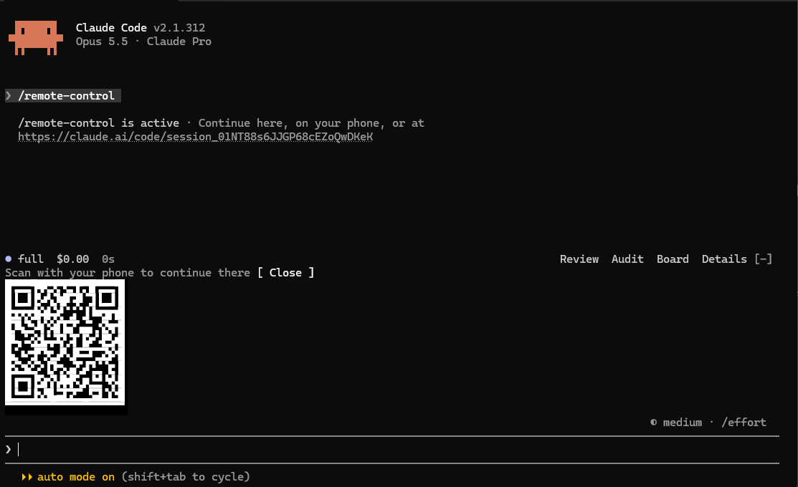
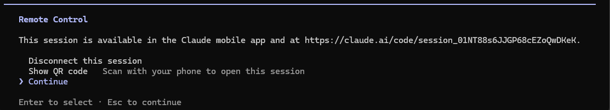

# remote-qr

A mod for [Claude Code](https://claude.com/claude-code) that shows a **QR Code** for the `/remote-control` link. Run the command, point your phone's camera at the terminal, and pick up the session on your phone with no copying and pasting.



## What it does

- When `/remote-control` connects, Claude Code prints the link as usual and the mod opens a band **right above the prompt** with the link's QR Code.
- The QR Code is compact (about 10 rows × 19 columns), so it fits even in short windows.
- The band goes away when you press **Close** or send your next message.
- If the session is **already connected**, `/remote-control` opens Claude Code's own menu and the mod stays out of the way:

  

- The code is drawn white on black, so it scans on light and dark terminals alike.
- No dependencies: the QR Code encoder is built into the mod (`hooks/qr.ts`).

## Install

In a terminal running Claude Code, type at the prompt:

```
/plugin install remote-qr --marketplace heberholanda/Claude-RemoteQR
```

Answer `y` to add the marketplace, then pick a scope (just you, or the project).

Or, from a shell:

```sh
claude plugin install remote-qr --marketplace heberholanda/Claude-RemoteQR
```

Then run `/reload-plugins` (or start a new session) and type `/remote-control`.

### Update and uninstall

```sh
claude plugin update remote-qr
claude plugin uninstall remote-qr
```

## Requirements

- A Claude Code version with mod (hooks module) support and `/remote-control`.
- A terminal that draws the Unicode 16 "octant" characters (U+1CD00–U+1CDE5). Tested on **Windows Terminal 1.24**, which draws them itself, whatever the font. On other terminals, your font needs to include them.

## Tips

- **Your phone won't read the code?** Turn up the screen brightness, hold the phone a little farther away, and avoid glare. Zooming the terminal in (`Ctrl` + `+`) makes the modules bigger.
- **Seeing empty boxes or `?` instead of a QR Code?** Your terminal or font lacks the octant characters. Update the terminal or switch to a font that has them (for example a recent Cascadia Code, or Iosevka).
- **No QR Code showed up?** The band only appears when `/remote-control` *connects*. If the session was already connected, the command opens its menu; disconnect there and run `/remote-control` again.
- **Closed the band by mistake?** Disconnect and connect again with `/remote-control`.

## How it works

1. The mod hooks the `/remote-control` command (`command.run`) and notes whether the session already had a remote id before the command ran.
2. Claude Code does not return the link as text, so the mod reads it from the local session file (`~/.claude/sessions/<pid>.json`, field `bridgeSessionId`, or the folder set by `CLAUDE_CONFIG_DIR`).
3. The connection comes up just after the command returns, so the mod waits in the background for up to about 15 seconds, without blocking the terminal.
4. Once it has the link, it encodes the QR Code (byte mode, error correction level M, versions 1 to 10) and draws it in a band above the prompt using octant characters: each character draws 2 × 4 modules, which keeps the modules square in a 1:2 terminal cell.

> **Note:** the session file is a Claude Code internal, not a public API. If a future version changes it, the QR Code stops showing up, but `/remote-control` keeps working as usual.

## Privacy

The mod only reads local files and makes no network requests. The session link never leaves your machine: it is shown only in your terminal, inside the QR Code.

## Layout

```
.claude-plugin/
  plugin.json         the mod's manifest
  marketplace.json    lets people install straight from this repository
hooks/
  hooks.json          points at the hooks module
  register.tsx        hooks /remote-control and draws the band
  qr.ts               dependency-free QR Code encoder
  register.test.tsx   tests
types/index.d.ts      the mod's state contract
docs/                 screenshots
```

## Development

Clone the repository and load the mod straight from the folder; it reloads whenever you save:

```sh
git clone https://github.com/heberholanda/Claude-RemoteQR
claude --plugin-dir ./Claude-RemoteQR
```

Validate and test:

```sh
claude plugin validate ./Claude-RemoteQR
claude plugin test ./Claude-RemoteQR
```

To type-check, run `tsc -p ./Claude-RemoteQR` after loading the mod once: Claude Code writes its types to `.claude-plugin/types/`.

## Credits

The QR Code encoder follows [Project Nayuki's reference implementation](https://www.nayuki.io/page/qr-code-generator-library) (MIT).

## License

[MIT](LICENSE) © Heber Holanda
